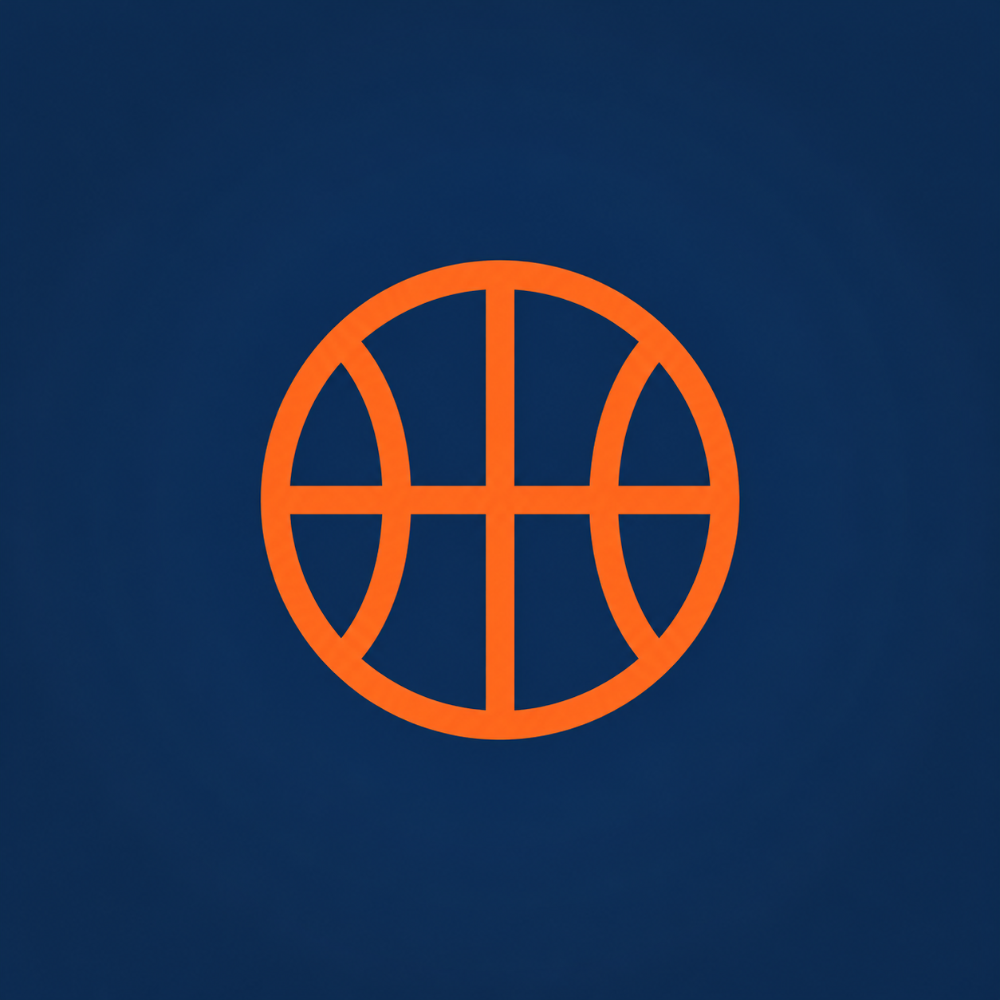

# Expo Basketball

A basketball scores app built with Expo, Expo Router, and Expo UI. It uses the existing [basketball API](docs/api.md) for NBA, WNBA, and college basketball data.

## Run a development build

Use Bun 1.2.22 or newer and Node 22 or newer for Expo's native tooling. iOS builds require Xcode and CocoaPods. Android builds require Android Studio and a configured emulator or device.

```sh
bun install --frozen-lockfile
bun run ios
```

For Android, run `bun run android`. To reconnect an installed development build, run `bun start`. The app has its own application identifier, `dev.expo.basketball`.

Commit dependency changes with `bun.lock`. Install Expo libraries with `bun expo install <package> --bun` so Expo selects compatible versions.

The default API needs no credentials. Copy `.env.example` to `.env.local` only when changing the API URL or configuring a notification service. `EXPO_PUBLIC_*` values are visible in the app bundle. Keep provider credentials on your server.

## Project layout

`src/app` contains Expo Router routes. `src/screens` contains screen bodies. Shared UI lives in `src/components`. The theme owns repeated visual values. Data validation and requests live outside route files.

Read the [implementation plan](docs/port-plan.md), [API reference](docs/api.md), [development diaries](docs/diary/README.md), and [decision trail](docs/decisions.tsv).

## Check the app

```sh
bun run check
bun run check:api
bun run export
bunx expo-doctor
```

`check` runs TypeScript, behavior tests, and public-file checks. `check:api` validates responses from the deployed service. Read the [verification record](docs/verification.md) for native checks and remaining device requirements.

## EAS Update

The app is linked to [exponathan/expo-basketball](https://expo.dev/accounts/exponathan/projects/expo-basketball). Build profiles use matching development, preview, and production channels and environments.

Rebuild an existing development client once with `bun run ios` or `bun run android` to include the updates module and project configuration. Preview published updates through the development client's Extensions UI.

To publish a preview update after building a compatible client:

```sh
bun run update:preview --message "Describe the change"
```

The [EAS Update guide](docs/eas-update.md) covers runtime compatibility, build profiles, and production publishing.

## Data and artwork

Basketball data and remote team and player images come from third-party services. Their availability does not grant ownership of league or team marks. This repository does not contain sports data snapshots or provider credentials.
