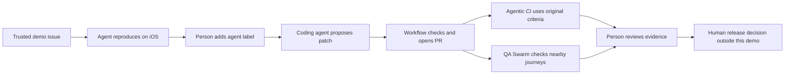

# PrizePicks presentation rehearsal

Show one game-day bug becoming a reviewable, device-tested PR. All four workflows have real cloud evidence. The final CI and QA runs passed at `705a42333c551953d62cf9c54156c2e17b2363bf`. Earlier triage and coding receipts establish the original issue-to-fix path. The recording timing limitation remains explicit below. Production promotion remains a human decision outside this demo.

## Thirty-minute agenda

| Minutes | Show | Explain |
| --- | --- | --- |
| 0–4 | The seeded Jordan Vale profile bug and its issue | The app uses fixed synthetic data, so the reproduction is repeatable. |
| 4–8 | A completed triage result, screenshots, and recording | An agent has to observe the reported behavior on the selected artifact. |
| 8–17 | Inspect the completed coding patch and PR. Optionally add `agent` to a fresh prepared issue | The workflow owns source selection, checks, commits, and publication. The person reviews the change. |
| 17–23 | Agentic CI's native build selection and device evidence | A matching fingerprint allows repack with the candidate's JavaScript. The original issue criteria define acceptance. |
| 23–27 | A completed QA Swarm with three distinct sessions | Scores, current player stats, and search/back run as separate lanes. Inspect every lane's evidence. |
| 27–30 | The connection to PrizePicks' release train and questions | Agent evidence can support their existing promotion decision. |

These are presentation allocations, not measured workflow completion times. Prepare completed runs for every segment. Keep the live issue-to-PR action optional if cloud timing would interrupt the talk.

## Prepare the rehearsal

1. Open [issue 3](https://github.com/SchroederNathan/expo-basketball/issues/3), [PR 4](https://github.com/SchroederNathan/expo-basketball/pull/4), and the completed workflow links below. Download their evidence before the meeting.
2. Follow [the workflow setup](agentic-workflows.md), [label bridge setup](agent-label-bridge.md), and [QA setup](qa-swarm.md) for any new run. Freeze a reviewed controller baseline and explicit target SHA until the run finishes.
3. Use `release/prizepicks-demo` as the prepared demo target and verify that it still contains the seed. Keep PR 4 open intentionally so the demo's seeded main and release target remain available. Do not merge the fix during the presentation.
4. Show the October 26, 2026 NBA fixture in America/Toronto. Scores are Orbits 100, Comets 108, Final. Search Jordan, then open Jordan Vale. The seeded 18.5 and 4.2 tiles lack labels. Avery Stone's current stats and Back navigation remain intact.
5. Open the historical REPLICATED triage evidence, then the original coding patch. Show the frozen [Jordan criteria](../demo/issues/player-label.md) beside the fix. In final-head CI, Jordan displays PTS 18.5 and STAT 4.2. Avery still displays PTS 24.0, REB 6.0, and AST 8.0.
6. Open final CI's source and repack identities, then its four passing original checks. Open QA's `scores`, `current-player`, and `search-back` evidence and the three distinct session receipts.
7. Show the historical INCONCLUSIVE startup example only if useful for questions. Explain the recorded failure and retained cleanup/auth outcomes. A live cancellation recovery has not been proved by these runs.

The fixture is synthetic and deterministic. Demo API requests never fall through to live data, and image fields use local fallbacks. Compare the embedded source badge and full identity receipt before presenting a screenshot as baseline or repaired evidence.

For an optional live coding run, create a fresh open issue from a trusted repository author. Include `<!-- lob-demo:player-label -->` and the unchanged criteria from `demo/issues/player-label.md`. Apply `agent-triage`, inspect its Actions dispatch and EAS result, then apply `agent`. Inspect **Agent issue bridge** for the explicit target and resolved SHA. Follow the EAS run through PR_READY and the PR's automatic acceptance check.

All subscription runs share one serialized `codex-subscription-agentic-ios` stream. QA uses three concurrent threads inside one app-server. Do not use the credential in another concurrent job or machine. Keep this same operator-authorized public repository.

The historical duplicate request reused the original candidate and PR without starting Codex or loading auth. Human merges have since changed PR 4's history. For a repeat coding exercise after a human merge, create a fresh issue and use a reviewed target that still contains the seed and current controller baseline. Re-labeling the old issue is not a reset. If the target already contains the fix, use the completed reproduction evidence or prepare another seeded target before the meeting.

Use account workflow links for navigation. Do not put credential-bearing preview links, private evidence paths, or credential paths into slides or source files.

## Keep the claims precise

A repack produces a simulator artifact containing the selected JavaScript. It does not publish an EAS Update. The demo's `agent-preview` channel is separate from a production release. Lob uses the `appVersion` runtime policy, and the audited runtime is `1.0.0`.

Native fingerprint lookup selects a compatible build to repack. It does not implement the fingerprint runtime policy in the supplied PrizePicks plan. The [release-context research](research/prizepicks-release-context.md) separates that plan from the public article and Lob's configuration. Scheduling, Sentry monitoring, OTA activation, rollout, rollback, and store submission remain outside the demonstrated scope. These runs provide no production rollout proof.

An INCONCLUSIVE result is useful to show. Explain its concrete cause and the evidence still missing. A completed build, a zero exit code, or a manually verified app is not an automated device acceptance pass.

## Current evidence

The final audit observed [PR 4](https://github.com/SchroederNathan/expo-basketball/pull/4) at `705a42333c551953d62cf9c54156c2e17b2363bf` on October 29, 2026 at 19:14 UTC. All 15 checks were SUCCESS. The PR was open, non-draft, and merge state CLEAN, with no submitted reviews. It remains open intentionally for the seeded demo. This is an observed snapshot, not an approval or merge instruction.

| Workflow | Exact result and scope |
| --- | --- |
| [Final Agentic CI](https://expo.dev/accounts/exponathan/projects/expo-basketball/workflows/01a18906-6503-7785-8de9-f9d00384177e) | Automatic `GITHUB_PULL_REQUEST_SYNCHRONIZE` run. PASS for `historical-points`, `unknown-stat`, `current-player`, and `search-back` against the original issue 3 criteria. |
| [Final QA Swarm](https://expo.dev/accounts/exponathan/projects/expo-basketball/workflows/01a18906-9946-7962-b6db-962f825ffb27) | Manual run bound to PR 4. PASS for all three generic journeys, with distinct sessions, attempts, threads, and completed turns. Common model-turn overlap was 51.629 seconds. |

Both targets and every admitted identity receipt bind the installed app to that final SHA and the unchanged `prizepicks-v1` fixture. CI installed repack `1179953c-33f1-40cc-9653-90c8d39a845e`. QA installed repack `b61185d7-4a8f-4f0b-9b8e-eeca618d956d`. Both used native fingerprint `5e4d3641e1f75c94bdf77b5a1b80d9d206962145` and runtime `1.0.0`. Independent build metadata verified provenance. Cold builds were skipped in these final runs.

The combined artifact audit rechecked hashes and fully decoded 15 PNGs and four original MP4s totaling 3,460 frames. All 15 PNGs and nine representative CI frames were visually inspected. QA recording visual sampling stopped at the timestamp failure. Accessibility observations come from completed cloud verdicts and pinned source, not a fresh auditor device snapshot. React key uniqueness was checked in source, not inferred from pixels.

The QA search-back MP4 has one backward presentation timestamp jump at zero-based frame 259, from 30.286667 to 30.285000 seconds. The 1.667 ms regression failed the stricter chronology audit. Duplicate timestamps remain in all four recordings. Decoder integrity and cloud acceptance passed. Clean source timing did not. Preserve original media. Any retimed presentation copy must be labeled edited playback and cannot establish elapsed workflow time.

Independent cloud reads confirmed STOPPED for the CI session and all three QA sessions. Both controllers recorded `auth=persisted`. QA reported healthy, unforced server shutdown with exit code 0. These receipts establish writeback and controller process cleanup. They do not prove token rotation or an independent kernel process inventory.

## Historical evidence for the complete story

These runs establish earlier workflow paths at their recorded revisions. They are not final-head rechecks.

| Evidence | Revision and observed result |
| --- | --- |
| [Manual baseline CI](https://expo.dev/accounts/exponathan/projects/expo-basketball/workflows/01a185ea-35e7-7406-93dc-19648335a00e) | `25e6adc8bb2097d3832304d3895f52ca75d684d5`. PASS for three baseline journeys, five PNGs, and 1,584 decoded frames. Jordan's seeded label defect was outside these criteria. |
| [Original triage](https://expo.dev/accounts/exponathan/projects/expo-basketball/workflows/01a18613-1186-705b-ae97-5f7f07f5dc8f) | `34b46867681fd283c9247e67be4bf54ae3db8611`. REPLICATED for the original issue. Six PNGs, 1,216 decoded frames, persisted auth, and independent STOPPED. The [issue comment](https://github.com/SchroederNathan/expo-basketball/issues/3#issuecomment-6488665890) matched the evidence. |
| [Original coding](https://expo.dev/accounts/exponathan/projects/expo-basketball/workflows/01a18615-a0cc-7e37-89d8-fadd3a6b0a32) and [duplicate request](https://expo.dev/accounts/exponathan/projects/expo-basketball/workflows/01a18622-5405-7eeb-8da2-23c3d2c83e35) | Frozen target `34b46867681fd283c9247e67be4bf54ae3db8611`. PR_READY published candidate `8aa8179391a149b84291b2e9759799b35a8aa398` in PR 4 with four app source/test files. The repeat reused that candidate and PR without starting Codex or loading auth. |
| [Earlier repaired CI](https://expo.dev/accounts/exponathan/projects/expo-basketball/workflows/01a18628-d68d-7b13-8993-694ec0b78eac) | `82c8a69490e0b4786f99d8cd70d86008cb0c12cd`. PASS for all four unchanged issue criteria, six PNGs, and 1,136 decoded frames. The marked PR comment matched that attempt at verification time and has since been updated to the final run. |
| [Repaired-candidate triage](https://expo.dev/accounts/exponathan/projects/expo-basketball/workflows/01a18629-2105-7ae5-a37f-09c800524396) | `82c8a69490e0b4786f99d8cd70d86008cb0c12cd`. NOT_REPLICATED against the original criteria. Six PNGs, 1,242 decoded frames, persisted auth, independent STOPPED, and a matching [issue comment](https://github.com/SchroederNathan/expo-basketball/issues/3#issuecomment-6489171845). |
| [Prepared-tools QA rehearsal](https://expo.dev/accounts/exponathan/projects/expo-basketball/workflows/01a188fc-a9d6-7ed5-9285-10dd8527afe9) | `758efdd896db2f2f2cd6bd104a4f36b0226fa29c`. PASS for three lanes with 41.572 seconds of overlap, nine PNGs, 1,917 decoded frames, independent STOPPED, persisted auth, and healthy server exit. |

Real issue-label events dispatched [triage](https://github.com/SchroederNathan/expo-basketball/actions/runs/40822027019) and [coding](https://github.com/SchroederNathan/expo-basketball/actions/runs/40822288240) at the frozen release SHA. EAS queued coding behind triage with no coding jobs started. The [subscription concurrency probe](https://expo.dev/accounts/exponathan/projects/expo-basketball/workflows/01a18610-217b-7052-85a2-5efc365bdb56) separately proved authenticated overlapping threads on Linux.

The historical baseline, original triage, and earlier repaired CI recordings each have a backward timestamp jump. Repaired triage has two. The prepared-tools QA rehearsal has duplicate timestamps but no backward jump. Keep those limitations attached to the run when reusing its media. The baseline workflow took about 7 minutes 16 seconds. One observed duration is not a completion guarantee.

The [first QA run](https://expo.dev/accounts/exponathan/projects/expo-basketball/workflows/01a18629-156f-7749-b2c7-6a1f75885b7c) was INCONCLUSIVE after two setup failures. Later diagnostics captured Bunx package-launch failures without proving their mechanism. The new tools-only Linux probe and full QA runs passed after preparation moved ahead of lane startup. The [QA runbook](qa-swarm.md#earlier-failures-and-the-diagnostic-boundary) retains the failure history, unknown causes, and exact passing probe link.

[Draft documentation feedback](research/agentic-workflows-docs-feedback.md) records the issues and recommendations found during implementation.
