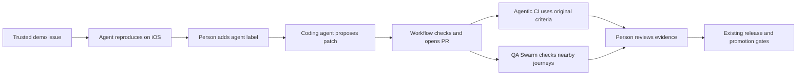

# PrizePicks presentation rehearsal

The story is a game-day bug becoming a reviewable, device-tested PR on an explicit release branch. PrizePicks keeps its release windows, store review process, and production approval gate.

## Thirty-minute agenda

| Minutes | Show | Explain |
| --- | --- | --- |
| 0–4 | The seeded Jordan Vale profile bug and its issue | The app uses fixed synthetic data, so the reproduction is repeatable. |
| 4–8 | A completed triage result, screenshots, and recording | An agent has to observe the reported behavior on the selected artifact. |
| 8–17 | Add `agent` to a fresh prepared issue, then inspect the generated patch and PR | The workflow owns source selection, checks, commits, and publication. The person reviews the change. |
| 17–23 | Agentic CI's native build selection and device evidence | A matching fingerprint allows repack with the candidate's JavaScript. The original issue criteria define acceptance. |
| 23–27 | A completed QA Swarm with three distinct sessions | Scores, current player stats, and search/back run as separate lanes. Inspect every lane's evidence. |
| 27–30 | The connection to PrizePicks' release train and questions | Agent evidence can support their existing promotion decision. |

These are presentation allocations, not measured workflow completion times. Prepare completed runs for every segment. Keep the live issue-to-PR action optional if cloud timing would interrupt the talk.

## Prepare the rehearsal

Follow [the workflow setup](agentic-workflows.md), [label bridge setup](agent-label-bridge.md), and [QA topology checks](qa-swarm.md). Freeze a reviewed baseline before dispatch. Keep its target ref and the EAS baseline variable unchanged until that run finishes.

Use `release/prizepicks-demo` for the demo train. Its source includes the seeded bug. The generated fix stays in a reviewable PR targeting that train. Keep a fresh marked issue ready for a live coding run. Repeating an already completed issue deliberately reuses its existing PR.

Before the meeting, retain these results from real cloud runs:

- Baseline Agentic CI PASS with exact embedded source identity, decodable screenshots and recording, confirmed session stop, and persisted subscription auth.
- Bug triage REPLICATED for Jordan's missing labels on that baseline.
- Issue to PR PR_READY, with the small source change and regression test visible on GitHub.
- Acceptance CI PASS for that candidate against the original issue criteria, plus its PR evidence comment.
- QA Swarm PASS with three distinct sessions and overlapping completed agent turns.
- A repeated issue dispatch that reuses the same PR, and an inconclusive or cancellation example that retains cleanup and auth outcomes.

Open the prepared issue, fix PR, EAS workflow pages, and downloaded evidence before presenting. Use the account workflow links for navigation. Do not put credential-bearing simulator preview URLs into slides or source files.

## Keep the claims precise

A repack produces a simulator artifact containing the selected JavaScript. It does not publish an EAS Update. The demo's `agent-preview` channel is separate from a production release, and Lob still uses the `appVersion` runtime policy.

The native fingerprint lookup illustrates a decision PrizePicks already makes. It does not implement their production scheduling, Sentry monitoring, rollout, rollback, or store submission rules. Show those as the next stage in their existing pipeline.

An INCONCLUSIVE result is useful to show. Explain its concrete cause and the evidence still missing. A completed build, a zero exit code, or a manually verified app is not an automated device acceptance pass.

## Current evidence

The [manual baseline Agentic CI run](https://expo.dev/accounts/exponathan/projects/expo-basketball/workflows/01a185ea-35e7-7406-93dc-19648335a00e) passed. Independent verification checked exact source and installed artifact identity, all three baseline journeys, five PNGs, complete recording decode, successful process termination, the persisted-auth receipt, and scoped STOPPED. This one workflow took about 7 minutes 16 seconds, including native lookup and repack. That is one observed run, not a completion-time guarantee.

The original recording contains one backwards timestamp jump. Keep it unchanged as evidence. A separate local presentation copy preserves all 1,584 decoded frames in order at a fixed 12 fps, with increasing timestamps and complete decode verified. Its playback timing is edited and cannot establish elapsed workflow time.

The [subscription concurrency probe](https://expo.dev/accounts/exponathan/projects/expo-basketball/workflows/01a18610-217b-7052-85a2-5efc365bdb56) passed on Linux. Real issue-label events dispatched [triage](https://github.com/SchroederNathan/expo-basketball/actions/runs/40822027019) and [coding](https://github.com/SchroederNathan/expo-basketball/actions/runs/40822288240) at the frozen release SHA. EAS queued coding behind triage with no coding jobs started.

[Triage](https://expo.dev/accounts/exponathan/projects/expo-basketball/workflows/01a18613-1186-705b-ae97-5f7f07f5dc8f) returned REPLICATED with the original four criteria, six decoded PNGs, a fully decoded recording, persisted auth, and independently confirmed STOPPED. Its [issue comment](https://github.com/SchroederNathan/expo-basketball/issues/3#issuecomment-6488665890) agrees with the downloaded evidence.

[Coding](https://expo.dev/accounts/exponathan/projects/expo-basketball/workflows/01a18615-a0cc-7e37-89d8-fadd3a6b0a32) opened [PR 4](https://github.com/SchroederNathan/expo-basketball/pull/4) with four app source/test files, successful checks, and persisted subscription auth. A [repeated request](https://expo.dev/accounts/exponathan/projects/expo-basketball/workflows/01a18622-5405-7eeb-8da2-23c3d2c83e35) returned the same PR and candidate without starting Codex or loading auth.

The first automatic PR check correctly stopped INCONCLUSIVE because EAS's shallow checkout lacked the frozen base commit. The controller now fetches missing history while keeping HEAD pinned; repaired acceptance and the three-session simulator swarm still need their cloud receipts. The PR retains its original issue and criteria receipt through this controller upgrade.

[Draft documentation feedback](research/agentic-workflows-docs-feedback.md) records the issues and recommendations found during implementation.
