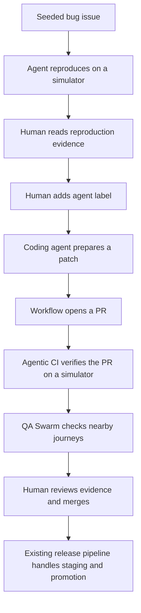

# Expo agentic workflows for the PrizePicks presentation

Reviewed: 2026-10-28. Status: internal research and a proposed demo plan. The Expo documentation below is an unreleased preview supplied for this discussion. Nothing in this note is an implemented workflow in Lob.

## Recommendation

Make the presentation about an issue becoming a reviewable, device-tested PR. Use a small QA Swarm as the second demonstration, and a prepared bug-triage result as the closing example.

The customer story stays the same: a native release is waiting for review while a game-day fix needs attention. Expo's draft workflows supply the missing agent behavior: reproducing an issue, writing a change, using the app, and returning evidence. PrizePicks' release train and human promotion gate provide the release context. The meeting does not need a full release controller built inside Lob.

Implement Agentic CI first, then Issue to PR, then a small QA Swarm. The draft Issue to PR guide depends on Agentic CI; the draft bug-triage guide depends on both. This is an implementation order, not the order in which the demo has to be presented. [Agentic CI][ci], [Issue to PR][issue], [Bug triage][triage]

## Sources

| Source | What it contributes | Status when reviewed |
| --- | --- | --- |
| [Introduction][intro] | Workflow, coding agent, and cloud simulator roles; human review of evidence | Draft preview |
| [Agentic CI][ci] | PR verification, native build reuse, repacking, verdicts, screenshots, recordings | Draft preview |
| [Issue to PR][issue] | An issue label starts a coding agent; a workflow opens the PR; Agentic CI checks it | Draft preview |
| [QA Swarm][swarm] | Parallel agents with a separate simulator and scoped flow for each lane | Draft preview |
| [Bug triage][triage] | Reproduction from GitHub issues or TestFlight feedback before requesting a fix | Draft preview |
| [PrizePicks release article][prizepicks] | Release-train motivation, existing checks, planned release gates and incident handling | Public first-party article |
| [Release context and app baseline](prizepicks-release-context.md) | Reconciles the article, the user's supplied plan, and repository observations | Internal research |

All five preview pages were retrieved directly. The web reader could not open the preview host; direct HTTPS retrieval succeeded. They were reviewed as source material, not executed as setup instructions.

## What the drafts make possible

### Agentic CI: evidence on the PR

The draft workflow fingerprints the native inputs, finds a compatible existing build or creates one, and repacks the PR's JavaScript into that build. A coding agent tests the behavior described by the PR on a cloud simulator. The PR comment links to a verdict, screenshots, recording, and a browser-preview launch. A non-PASS verdict fails the result job. Scripted tests remain part of the process. [Agentic CI][ci]

Proposed Lob demonstration: change how a player stat label handles an older response shape. Show an agent navigating to the profile and checking the visible result. Give the checking agent the original issue's acceptance criteria as well as the PR description; the generated summary should not be its only definition of success.

PrizePicks connection: an additional source of release evidence beside their existing unit, type, lint, cycle, and Maestro checks. Present this as behavior-focused review assistance. Whether it becomes a required gate is a decision for their team.

### Issue to PR: start from the team's existing work queue

In the draft, a person adds the `agent` label to an issue. A GitHub Action bridges that event to EAS Workflows. The coding agent reads the issue and changes code; the workflow commits the change, opens `agent/issue-<number>`, and creates the PR. Agentic CI tests the PR. A person reviews and merges it. [Issue to PR][issue]

Proposed issue, deliberately seeded for the demo:

> A player stat label is missing with the older API fixture. Derive the label from the known stat identifier when possible; otherwise show an unavailable state. Preserve the current response behavior and test both response versions.

Acceptance criteria:

- The older fixture renders a correct fallback for a known stat identifier.
- An unknown identifier produces an unavailable state instead of a guessed label.
- The current fixture retains its intended label and value.
- Opening another player does not reuse the previous player's state.
- The patch introduces no native dependency or native configuration change.

PrizePicks connection: a small, reviewable candidate for their same-day JS path. The draft implementation starts from the default branch. Targeting a frozen release branch is an adaptation we must implement explicitly, not a capability to assume is already present.

### QA Swarm: check several customer journeys at once

Each draft lane gets one short Markdown flow and its own cloud simulator. Jobs run in parallel, and the workflow gathers their verdicts and evidence. The example authors explicit lane jobs; it does not use a matrix. Each flow defines steps, excluded actions, and a pass condition. [QA Swarm][swarm]

Use three small, read-only Lob flows:

| Lane | Flow | Evidence to inspect |
| --- | --- | --- |
| Scores | Open a fixed date, choose a seeded game, inspect the score | Correct teams, score, and game destination |
| Player | Open the seeded player and inspect the stat label | Correct label and value under the chosen API fixture |
| Search | Find a seeded player, open the profile, return | Correct player and preserved search query |

Use synthetic data with fixed identifiers and independent lane state. These are Lob's real app journeys; entry submission is a possible future PrizePicks lane, not a feature this project has.

PrizePicks connection: parallel exploration before a deployment window. The elapsed time depends on provisioning, the slowest lane, and reporting. Do not claim a measured speedup until the actual runs have been timed.

The draft evidence-site command deploys to EAS Hosting, where anyone with the link can view it. Use synthetic demo data. For private evidence, follow the draft's artifact/private-host alternative instead of its public deployment option. [QA Swarm][swarm]

### Bug triage: establish a reproduction before asking for a fix

The draft accepts a GitHub issue or iOS TestFlight feedback. It runs a default-branch build on a simulator, records a reproduction attempt, and comments on the issue. A person reviews a replicated result before adding the `agent` label to start Issue to PR. Missing verdicts become INCONCLUSIVE. [Bug triage][triage]

Proposed demo: show a prepared report for the same player-label bug, including the steps, screenshot, and recording. Then show the handoff to the fix PR.

PrizePicks adaptation: their older supported release may differ from the default branch. Carry the reported platform, release ref, build ID, runtime, update ID, and API fixture into triage. Add selection of the matching artifact before treating NOT-REPLICATED as useful evidence. This artifact selection is proposed work; the draft explicitly tests the default branch, not the tester's original build.

Start with the GitHub-issue path. TestFlight adds App Store Connect setup, a TestFlight build, iOS-only intake, and expiring screenshot links. The draft creates an issue per feedback report without deduplicating them. These are reasons to prepare that path separately. [Bug triage][triage]

## End-to-end demo shape



This combines the draft building blocks into a proposed presentation. QA Swarm is a separate workflow in the draft, not an automatically connected stage in Issue to PR. Staging, production publication, and rollback are separate release work; the draft agent flows do not merge or ship on their own. [Introduction][intro], [Issue to PR][issue], [QA Swarm][swarm]

## Keep these distinctions visible

1. **A repack is not an OTA rollout.** The draft injects candidate JavaScript into a simulator build. That proves behavior of that artifact, not that an installed production app downloaded an EAS Update through its channel. Demonstrate channel download and activation separately if OTA delivery is part of the talk. [Agentic CI][ci], [Lob update guide](../eas-update.md)
2. **Build lookup and update compatibility are different uses of fingerprints.** The draft uses fingerprints to find a native build for simulator verification. Lob still uses `appVersion` for EAS Update runtimes. Adopting the draft agent workflows does not itself migrate that policy. A faithful fingerprint-runtime release demo requires an intentional configuration change and fresh compatible binaries. [Agentic CI][ci], [Runtime versions][runtimes], [app config](../../app.json)
3. **A default-branch check does not validate every release train.** Add explicit target-ref handling for backports and reported incidents. Validate each patch against the relevant installed native build and target environment. The user-supplied plan is the source for the one-review-per-platform rule; the public article describes a different queue option. [Issue to PR][issue], [Bug triage][triage], [Release context](prizepicks-release-context.md)
4. **An agent verdict supplements deterministic checks.** Keep Bun behavior tests and a short Maestro smoke flow. Use the agent for interpreting acceptance criteria, navigating the app, and recording evidence. Do not infer production readiness from a screenshot or a generated PASS alone. [Agentic CI][ci]
5. **The infrastructure needs account access.** The drafts label Expo Simulators as a limited-access preview for selected partners, separate from ordinary paid/free plan inclusion. Verify availability before committing to a live cloud demo. The Agentic CI draft also flags Android support as still in development. [Introduction][intro], [Agentic CI][ci]

## Proposed project additions

These paths are a plan, not files created by this research:

```text
.eas/
  agents/
    run-agent.sh
    start-session.sh
    check-pr.md
    make-change.md
    qa-lane.md
    reproduce.md
    github.mjs
    make-change.sh
    qa-lane.sh
    reproduce.sh
  qa-flows/
    scores.md
    player-label.md
    search.md
  workflows/
    agentic-ci-ios.yml
    issue-to-pr.yml
    qa-swarm.yml
    bug-triage.yml
.github/workflows/
  agent-label.yml
.maestro/
  player-label-smoke.yml
demo/
  issues/
    player-label.md
  fixtures/
    api-previous.json
    api-current.json
```

The draft file and helper names are starting points. Additional platform workflows, the feedback formatter, runtime metadata, and a controlled OTA promotion workflow can follow after the main story works.

## Setup order

1. Confirm the EAS/GitHub connection, Expo Simulators access, a CI-capable coding agent, and a suitable simulator build profile. Lob is a CNG app with configured application identifiers, which matches the draft starting point. The existing preview iOS profile needs simulator suitability checked; the development profile alone is not the release-style test artifact. [Agentic CI][ci], [eas.json](../../eas.json)
2. Add the synthetic fixtures, one seeded issue, and clear acceptance criteria. Adapt installation and checks to Bun 1.2.22 and the commands in [package.json](../../package.json); the draft GitHub Action's `npm ci` is an example, not this repo's install command.
3. Add the agent runner and one iOS Agentic CI workflow. Keep existing checks, then verify a known pass and a known failure. Validate the actual workflow files with EAS CLI when they are implemented.
4. Add Issue to PR and the label bridge. Carry the original acceptance criteria into the verification prompt. Exercise the draft's paths for no change and forbidden workflow-file edits, not only its successful path. [Issue to PR][issue]
5. Add the three-lane QA Swarm. Keep simulator state and test data independent, record the chosen source ref and build IDs, and inspect the result of every lane. Add Android after its path has been rehearsed.
6. Prepare a bug-triage run against the selected demo artifact. Treat release-ref selection as an explicit extension. The basic default-branch path can be used first if the seeded bug is on that branch.
7. Add an optional release-info screen and a separate staging OTA proof. Keep production configuration rebundling, approval, and rollback in the controlled release path from the earlier plan. Recheck the rebundled artifact's native compatibility. [Environment configuration][env], [Lob update guide](../eas-update.md)

The drafts use a Developer-role robot token, CI agent credentials, and repository-scoped GitHub write access where needed. They state that the agent can read the job environment. Configure an agent environment without unrelated release credentials, and retain human review before merge or production promotion. Setup secrets belong in the service's secret store, never these research files. [Agentic CI][ci], [Issue to PR][issue]

## Proposed 30-minute presentation

| Minutes | What to show | Preparation |
| --- | --- | --- |
| 0-3 | One game-day issue and why native review should not block a compatible fix | Release-train diagram and seeded issue ready |
| 3-12 | Issue to PR followed by Agentic CI evidence | Warm compatible build; completed example run available |
| 12-20 | Three QA lanes and the collected evidence | Independent fixtures and a prepared report |
| 20-25 | Bug triage and the human handoff into a fix | Prepared reproduction; show selected artifact identity |
| 25-30 | Questions and where this fits their release gate | Distinguish preview features, implemented setup, and proposals |

Start one fresh run and keep completed runs and recordings ready. Provisioning, first native builds, model execution, and CI queues have variable duration. A replay must be described as a replay. A simultaneous three-lane display is useful only after those lanes work reliably in rehearsal.

OTA activation or a rollback can replace the closing triage example if release mechanics are the audience's priority. Use an isolated demo channel and a known-good group for the same platform/runtime. Do not squeeze all four draft workflows, a native build, and a full incident controller into the live portion.

## Follow-up questions to resolve during implementation

- Does the presenting Expo account have cloud simulator access and enough concurrent sessions for the selected lanes?
- Which agent and controller are supported and rehearsed for this presentation? Use one runner/controller combination initially.
- Which branch and native artifact should each issue, backport, and triage run target?
- Can the verification workflow load and identify the actual staged OTA if OTA gating is claimed, rather than only a repacked build?
- Which evidence links are account-protected, and which Hosting pages are public?
- After the docs publish, what canonical URLs and validated examples replace this preview?

[intro]: https://pr-52087.expo-docs.pages.dev/agentic-workflows/introduction/
[ci]: https://pr-52087.expo-docs.pages.dev/agentic-workflows/agentic-ci/
[issue]: https://pr-52087.expo-docs.pages.dev/agentic-workflows/issue-to-pr/
[swarm]: https://pr-52087.expo-docs.pages.dev/agentic-workflows/qa-swarm/
[triage]: https://pr-52087.expo-docs.pages.dev/agentic-workflows/bug-triage/
[prizepicks]: https://labs.prizepicks.com/continuous-deployment-for-react-native-when-you-cant-break-on-game-day/
[runtimes]: https://docs.expo.dev/eas-update/runtime-versions/
[env]: https://docs.expo.dev/eas/environment-variables/usage/
