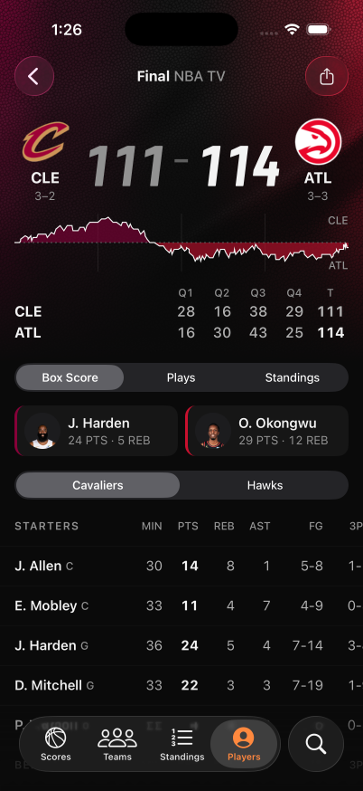

# Game curtain verification

Checked October 30, 2026. The port retains the original WGSL, indexed mesh, leather mip bytes, and shader uniform layout.

## Native screen

[EAS iOS simulator build](https://expo.dev/accounts/exponathan/projects/expo-basketball/builds/a44a9170-89b1-43ca-a95a-ae93fcfcd684) finished successfully from commit `5e85eb9a8620c6ffd46e059066379c2170f0c32a`. It includes the device-loss recovery fix, uses app version 1.0.1, and was built with the `simulator` release profile.

The branch was subsequently rebased onto newer cloud-automation changes. The application source, assets, app configuration, dependencies, lockfile, and build profiles still match the installed build. Application and cloud-runner type checks and all 152 application tests passed after the rebase.

The installed build ran on an EAS iPhone simulator with a 402 by 874 point viewport. Cleveland at Atlanta, game `401909893`, loaded real game data and showed the 111 to 114 final score.

- The textured fabric rendered beneath the scores and transparent navigation bar. Separate captures changed in an unobstructed fabric region, confirming motion rather than a static fallback.
- Box Score and Plays remained usable through the decorative layer.
- Scrolling down moved the curtain completely out of view. Returning to the top restored it without a blank header.
- A pull gesture at the top retained the game and fabric. Backgrounding into Settings and reopening Lob restored the same usable game screen.

The recording exported successfully without touch markers. Adding those markers exceeded the device tool's overlay export deadline. The billed simulator was shut down after verification.

## Automated checks

- `bun run check` passed TypeScript, 152 tests, and public-file checks.
- `bun run check:curtain` regenerated all 349,524 texture bytes from the original Rust generator and verified the source and generated asset checksums.
- `bun run check:curtain:gpu` passed on Chromium SwiftShader with no GPU validation errors. It checked rendered team colors, scissoring, completed-frame readiness, moving wind, pause/resume, reduced motion, palette changes, resizing, late acquisition, disposal, and bounded device-loss recovery.
- An independent renderer using the original shader and Rust-generated texture matched production renderer pixels byte-for-byte at zero and ten seconds, at 402 by 688 pixels and device pixel ratio one.
- iOS, Android, and static web exports passed. The export check found the exact nine-mip texture in every platform bundle and kept native graphics imports out of web.
- Before the rebase, the cloud-agent suite passed 254 tests, including candidate-version acceptance and build-runtime mismatch rejection. Four unchanged pinned Codex startup checks failed because their tool did not start in this environment. Both existing workflow graph checks passed again after rebasing. The newly merged TesterArmy runner also reads the candidate app version; its offline suite was not rerun.

## Limits

The pixel comparison establishes parity on one software GPU backend. Native validation establishes visible motion, compositing, and interaction on an iOS simulator. It does not establish native pixel equality with the Exact app, physical-device performance, or Android native rendering. Reduced motion and GPU loss were exercised in the real browser GPU harness; the simulator's OS reduced-motion setting was not toggled.
